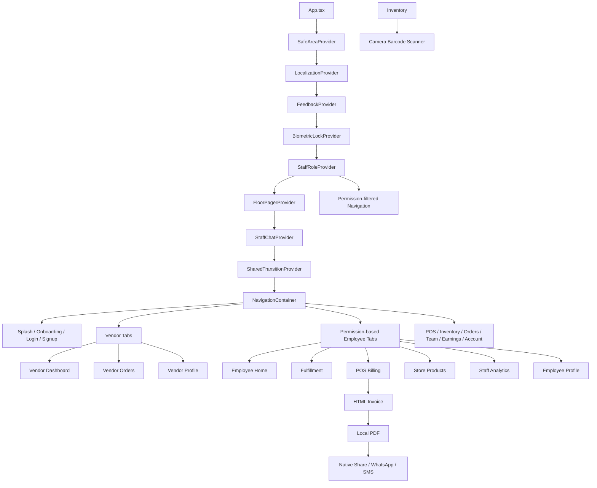

<div align="center">

# SmartMart Vendor

### Retail Operating System, Store POS, and Employee Operations App

[](https://reactnative.dev)
[](https://react.dev)
[](https://www.typescriptlang.org)
[](https://reactnavigation.org)
[](#platform-support)
[](#pos-billing-and-invoice-flow)
[](#license)

<br/>

**A supermarket and retail operations mobile app for vendors, managers, cashiers, inventory staff, order specialists, and supervisors**

[Features](#features) • [Architecture](#architecture) • [Vendor Experience](#vendor-experience) • [Employee Experience](#employee-experience) • [POS Billing](#pos-billing-and-invoice-flow) • [RBAC](#staff-roles-and-permissions) • [Project Structure](#project-structure) • [Quick Start](#quick-start)

</div>

---

## Overview

SmartMart Vendor is a React Native retail operations prototype. It combines store management, order fulfillment, inventory operations, point-of-sale billing, team coordination, staff permissions, earnings, and store configuration in one mobile application.

The app supports two primary personas:

- **Vendor/owner:** Store dashboard, order queue, inventory entry points, earnings, team management, and vendor configuration.
- **Employee:** Permission-based home, fulfillment, billing/POS, products, staff analytics, and employee profile.

The application is feature-based and uses React Context, AsyncStorage, React Navigation, native camera, PDF, sharing, image-picker, biometric, and Razorpay packages.

> **Current product status:** Most screens contain prototype or local demo data. The vendor specification documents an intended enterprise backend, but the primary app does not currently include a live REST backend, SQL database, WebSocket service, authentication server, inventory synchronization, or payout provider.

---

## Features

### Authentication and onboarding

- Animated splash screen
- Vendor/employee onboarding
- Login and signup screens
- Persona/role selection
- Phone/country validation
- Demo OTP UI
- Fixed demo OTP behavior where implemented
- Vendor or employee navigation after verification
- Persistent biometric app lock
- Background/foreground re-lock behavior

### Vendor dashboard

- Open/closed store status toggle
- Animated live store-status pulse
- Language switcher
- Today's sales
- Today's order count
- Pending order count
- Low-stock count
- Quick-action grid
- Pending order summary
- Low-stock summary
- Billing, inventory, scanner, team, earnings, settings, help, and profile entry points
- Loading/shimmer placeholders
- Animated entrance cards

### Employee dashboard

- Employee/workshift status
- Role-aware metrics
- Billing, fulfillment, inventory, attendance, and team shortcuts
- Manager-only analytics where allowed
- Permission-filtered actions
- Manager summon/floor-pager entry
- Task/activity summary

### Store order management

- Searchable vendor order queue
- Status filters
- All, New, Packing, Ready, Delivered, or equivalent demo statuses
- Count cards by status
- Order status badges
- Live pulse on incoming/new order cards
- Customer/location/item summary
- SLA/countdown indicators where implemented
- Order-detail view
- Stage progression
- Empty state and refresh behavior

### Dark-store fulfillment

- Employee fulfillment tab
- Permission-controlled visibility
- `To Pick` stage
- `Packing` stage
- `Ready for Rider` stage
- Item picking workflow
- Quantity/order verification
- Staging-bay or rider handoff presentation
- Barcode verification entry

### Inventory and catalog

- Product search
- Stock and category filtering
- In-stock/out-of-stock status
- Stock quantity
- Low-stock filtering
- Add product
- Edit product
- Product name and description
- Category
- SKU/barcode
- MRP and selling price
- Unit/pack size
- Image
- Shelf, aisle, or rack fields where implemented
- Active/inactive status
- Product cards and badges
- Inventory summary

### Barcode scanner and price checker

- CameraKit barcode scanner
- Scanner/price-checker route aliases
- Barcode/SKU lookup
- Product result state
- No-match state
- Camera preview
- Success/error feedback
- Scanner configuration entry points
- Haptic/audio settings where implemented

### POS counter billing

- Barcode/product search
- Category filtering
- POS product/cart
- Product add and remove
- Quantity increment/decrement
- Clear cart
- Cart bounce feedback
- MRP and selling-price display
- Savings calculation
- Subtotal calculation
- Sample tax/GST calculation
- Final payable amount
- Cash tender input
- Change calculation
- Customer mobile validation
- Cash, card, UPI, and other demo payment modes
- Compact and document receipt modes
- Final-bill confirmation

### GST/PDF invoicing

- Invoice preview
- Store/vendor information
- Invoice number
- Customer mobile
- Item quantity and price
- Discount/savings
- Tax line
- Total payable
- Payment method
- Cash/change details
- HTML invoice document generation
- On-device HTML-to-PDF conversion
- Native share sheet
- WhatsApp sharing action
- SMS sharing action
- Generated success checkmark
- Share/permisssion error handling

### Team and employee operations

- Employee directory
- Add employee
- Employee detail
- Employee role/persona switch
- Custom role permissions
- Shift attendance
- Employee tasks/activity
- Employee preferences
- Guidelines/SOP
- Permissions guide
- Notice board
- Store/vendor contact
- Team analytics
- Leave-request UI
- Staff chat list and conversations

### Staff role and RBAC

- Vendor owner role
- Store manager role
- Cashier/biller role
- Order specialist role
- Inventory clerk role
- Store supervisor role
- Permission-controlled tabs
- Permission-controlled action visibility
- Staff management permissions
- Billing/product/order permission groups
- Manager-only analytics

### Floor communication

- Staff role switcher
- Team chat
- Notice board
- Manager summon
- Floor pager
- Counter/aisle/employee targeting where implemented
- Haptic and overlay feedback
- Incoming team alert presentation

### Earnings and settlement

- Earnings overview
- Gross sales
- Order value
- Commission
- Net payable
- Pending/available earnings
- Settlement history
- Settlement detail
- Settlement status and date
- Reference/bank detail display

### Store configuration and profile

- Vendor profile
- Store profile
- Store address
- Working hours
- Commission rate
- Notification preferences
- App settings
- Language preference
- Logout and account actions
- Payment methods UI
- Privacy policy
- Terms of service

### Shared UI system

- Animated tab icons
- Active glow
- Native-stack transitions
- Entrance animation
- Skeleton loading cards
- Live-pulse beacon
- Success checkmark animation
- Cart bounce badge
- Bottom sheets
- Shared feedback provider
- Localized text and inputs
- Safe-area layouts

---

## Application Preview

The vendor app includes a master specification with screenshots and product-showcase galleries. The README links available assets through the specification and documentation folders.

| Store operations | POS and inventory | Fulfillment and team |
|:---:|:---:|:---:|
| Vendor dashboard | Store billing/POS | Order picking queue |
| Store status and working hours | Product/stock management | Packing and rider handoff |
| Earnings and settlements | Barcode scanner | Staff roles and permissions |
| Team analytics | PDF invoice sharing | Floor pager/chat |

See the existing gallery and screen references in:

- [`docs/SMARTMART_VENDOR_SYSTEM_SPECIFICATION.md`](./docs/SMARTMART_VENDOR_SYSTEM_SPECIFICATION.md)
- [`docs/assets/`](./docs/assets/)

---

## Technology Stack

| Area | Technology |
|---|---|
| Framework | React Native 0.88.0 |
| UI library | React 19.3.0 |
| Language | TypeScript 6.0.3 |
| Navigation | React Navigation native-stack and bottom-tabs |
| State | React Context, hooks, and component state |
| Persistence | AsyncStorage for supported preferences |
| Biometrics | react-native-biometrics |
| Barcode | react-native-camera-kit |
| Images | react-native-image-picker |
| PDF | react-native-html-to-pdf |
| Sharing | react-native-share |
| Payment package | react-native-razorpay |
| Icons | Feather, Ionicons, Material Icons |
| Safe areas | react-native-safe-area-context |
| Testing | Jest and React Test Renderer |
| Tooling | Metro, Babel, ESLint, Prettier |

The app requires Node.js 22.11 or newer according to its package configuration.

### Main dependencies

- `@react-navigation/native`
- `@react-navigation/native-stack`
- `@react-navigation/bottom-tabs`
- `@react-native-async-storage/async-storage`
- `react-native-biometrics`
- `react-native-camera-kit`
- `react-native-html-to-pdf`
- `react-native-image-picker`
- `react-native-razorpay`
- `react-native-share`
- `react-native-safe-area-context`
- `react-native-screens`
- Vector icon packages from `@react-native-vector-icons`

---

## Architecture



### Provider responsibilities

| Provider | Responsibility |
|---|---|
| `LocalizationProvider` | Language and translation state |
| `FeedbackProvider` | Shared success/error and confirmation feedback |
| `BiometricLockProvider` | App lock and authentication-route state |
| `StaffRoleProvider` | Current employee role and permission matrix |
| `FloorPagerProvider` | Manager summons and floor-pager state |
| `StaffChatProvider` | Local team-chat state and routing support |
| `SharedTransitionProvider` | Shared image/overlay transition state |

### Navigation behavior

- Native-stack root navigation
- Vendor bottom-tab navigation
- Employee permission-controlled bottom tabs
- Hidden native headers
- Slide/fade-style transitions
- Freeze inactive screens
- Route-based biometric lock
- Shared overlay/transition return behavior
- Manager summon overlay mounted above navigation

---

## Authentication

### Splash

- Vendor/SmartMart launch presentation
- Decorative animation
- Loading/transition state
- Session/role navigation entry

### Onboarding

- Multi-card introduction
- Vendor/employee presentation
- Next/Skip actions
- Login navigation

### Login

- Country/phone input
- Vendor/employee role selection
- Client-side validation
- Demo OTP modal
- Vendor navigation to `MainNavigation`
- Employee navigation to `DeliveryNavigation`

### Signup

- Full name
- Role/persona selection
- Phone number/country
- Demo OTP validation
- Account setup UI

> Authentication is demonstration UI. It does not create a server-backed account, JWT session, vendor assignment, or employee authorization record.

---

## Vendor Experience

## Vendor bottom navigation

| Tab | Screen | Purpose |
|---|---|---|
| Home | `VendorHomeScreen` | Store dashboard and command center |
| Orders | `VendorOrdersScreen` | Vendor order queue |
| Profile | `ProfileScreen` | Vendor profile and configuration |

## Store dashboard

The vendor dashboard is the operational command center.

It includes:

- Open/closed store status
- Live status beacon
- Store name/status summary
- Current language
- Today's sales
- Today's orders
- Pending fulfillment
- Low-stock items
- Quick links to POS, inventory, scanner, team, earnings, settings, and support
- Pending-order preview
- Stock warning preview
- Skeleton/loading states
- Animated card entrance

The store status control updates local/provider state; it does not currently publish store availability to a live API.

## Vendor profile

Vendor profile and account access include:

- Store identity
- Owner information
- Contact details
- Store address
- Working hours
- Commission rate
- Notification preferences
- Payment methods
- Earnings
- Logout
- Help/support/legal entries

---

## Vendor Orders

`VendorOrdersScreen` displays the vendor fulfillment queue.

### Queue controls

- Free-text search
- Status chips
- Order count cards
- New/Packing/Ready/Delivered filters
- Order card selection
- Empty-state feedback

### Order cards

- Order number
- Customer/receive time
- Fulfillment status
- Item count
- Total
- Pickup/delivery location
- Priority/SLA presentation
- Bag/staging identifier where implemented

### Order details

`OrderDetailScreen` displays:

- Order identity
- Status timeline
- Customer details
- Delivery address
- Item list and quantity
- Product/stock details
- Order subtotal and fees
- Packing/ready action
- Rider/fulfillment handoff
- Call/support entry
- Cancellation/rejection controls where implemented

No order WebSocket or backend event stream currently drives these screens.

---

## Employee Experience

## Employee bottom navigation

Employee tabs are filtered at runtime from the current employee permissions.

| Tab | Visibility condition | Purpose |
|---|---|---|
| StoreHome | Always | Employee dashboard |
| Fulfillment | `permissions.orders.view` | Omnichannel picking |
| Billing | `permissions.billing.view` | POS billing |
| Products | `permissions.products.view` | Store products/inventory |
| StaffAnalytics | Manager role or `staff.manage` | Team/shift analytics |
| Profile | Always | Employee account/preferences |

## Employee dashboard

The employee dashboard includes:

- Shift/attendance summary
- Store status
- Role/persona badge
- Fulfillment queue summary
- Billing/POS shortcut
- Stock warning summary
- Team/chat/notice shortcuts
- Manager summon controls
- Permission-dependent actions

## In-store fulfillment

The fulfillment flow provides three main stages:

```text
To Pick
   ↓
Packing
   ↓
Ready for Rider
```

Possible actions include:

- Search/open an order
- View aisle/rack/item location
- Mark an item picked
- Check quantities
- Move an order to packing
- Mark packing complete
- Allocate staging/bag ID
- Mark ready for rider
- Start/order barcode verification

Data is local/prototype until connected to a fulfillment service.

## Employee profile

The employee profile includes:

- Employee name/role
- Shift status
- Permissions summary
- Attendance entry
- Tasks/activity
- Preferences
- Team chat and notice board
- Guidelines/SOP
- Vendor/store contact
- Logout

---

## Inventory and Catalog

## Inventory overview

The inventory screen provides:

- Product search
- Stock filters
- Low-stock list
- In-stock/out-of-stock badges
- SKU/barcode
- Selling/MRP prices
- Product quantity
- Category
- Product card actions
- Add/edit navigation
- Scanner navigation

## Store products

The store-product screen is the employee/vendor inventory view.

It supports:

- Store product list
- Stock search
- Category/filter controls
- Add to store catalog
- Edit existing product
- View low-stock inventory
- Update stock fields
- Navigate to product form

## Product form

The product form contains or accepts fields for:

- Product name
- Description
- Category
- Barcode/SKU
- MRP
- Selling price
- Stock quantity
- Low-stock threshold
- Unit/pack size
- Product image
- Shelf/aisle/rack location
- Active/inactive status

Validation and persistence depend on the local screen implementation and should be backed by a catalog/inventory API before production.

## Low stock

The low-stock screen provides:

- Reorder-style list
- Current stock
- Low-stock threshold
- Product location
- Supplier/replenishment entry point where implemented
- Navigation into product edit/details

---

## Barcode Scanner

The app exposes `ScanBarcode` and `BarcodeScanner` root routes for the same scanner-style experience.

### Scanner capabilities

- Native camera preview
- CameraKit integration
- Barcode/SKU scan result
- Product match lookup
- Price/check result
- No-result/error feedback
- Haptic feedback
- Beep/audio feedback where implemented
- Low-light and autofocus configuration entry points where implemented

The scanner does not currently perform live server inventory lookup unless a future service is connected.

---

## POS Billing and Invoice Flow

`StoreBillingScreen` is the primary POS implementation.

## Product selection

- Search product by name/SKU
- Filter by category
- Open camera barcode search
- Select seeded POS products
- Add product to POS cart
- Display MRP/selling price

## POS cart

- Add quantity
- Increase/decrease quantity
- Remove item
- Clear cart
- Cart total
- Animated cart badge
- Empty cart state

## Pricing

The billing demo calculates:

- Subtotal
- MRP savings
- Sample tax/GST
- Final payable amount
- Cash received
- Change due

The exact tax presentation should not be considered legally compliant without a production tax configuration and server-authoritative ledger.

## Customer details

- Optional customer mobile
- Phone validation
- Invoice customer destination
- WhatsApp/SMS sharing destination

## Payment methods

- Cash
- Card
- UPI
- Other demo method UI

## Checkout controls

- Check total
- Clear/change cart
- Tender cash
- Complete payment
- Generate invoice
- Preview receipt
- Share receipt

## Invoice preview

The invoice preview includes:

- Store branding
- Invoice number/date
- Item name
- Item quantity
- MRP/selling price
- Savings/discount
- Subtotal
- Tax/GST
- Final amount
- Cash tender/change
- Customer mobile
- Payment method
- Store address/configuration where present

## PDF generation

The app uses HTML and native PDF conversion packages:

```text
InvoiceDocumentGenerator
    ↓
Invoice HTML
    ↓
react-native-html-to-pdf
    ↓
PDF file
    ↓
react-native-share
```

### Sharing options

- Native share sheet
- WhatsApp direct share
- SMS/direct link action
- PDF/receipt fallback
- Share/download permission handling

PDF generation and sharing are local-device operations. They do not upload the invoice to cloud storage or create a server-side tax ledger.

---

## Staff Roles and Permissions

The `StaffRoleContext` defines the current employee and permission matrix.

## Default personas

| Role | Persona | Typical access |
|---|---|---|
| `VENDOR` | Store owner/proprietor | Full store administration |
| `MANAGER` | Store manager | Operations, catalog updates, fulfillment, staff oversight |
| `BILLER` | Cashier/counter staff | POS billing and daily cash operations |
| `ORDERS` | Online-order specialist | Picking, packing, ready-for-rider workflow |
| `INVENTORY` | Stock/inventory clerk | Products, stock, inward and low-stock operations |
| `SUPERVISOR` | Floor supervisor | Monitoring, limited stock/order operations |

## Permission groups

Permission areas include:

- Billing
  - View
  - Create
  - Update
  - Void
- Products
  - View
  - Create
  - Update
  - Delete
- Orders
  - View
  - Create
  - Update
  - Delete
- Staff
  - View
  - Manage
- Inventory
  - View/adjust
- Financial
  - View store/settlement summary

## Permission enforcement

The app uses permission values to:

- Display/hide bottom tabs
- Display/hide staff analytics
- Limit employee dashboard actions
- Condition selected navigation and action controls

Client-side role filtering is not authorization. Production APIs must independently verify role and permission on every sensitive operation.

---

## Team Management

## Team roster

- Employee list
- Search/filter
- Employee role
- Shift/availability
- Employee detail navigation
- Add employee
- Team member status

## Employee detail

- Profile
- Role
- Shift
- Contact
- Activity
- Attendance
- Tasks
- Preferences
- Permissions guide entry

## Team analytics

Available to manager/store-owner roles or permission holders.

Includes:

- Team activity overview
- Role/persona breakdown
- Shift attendance summary
- Operational task summary
- Fulfillment/billing/stock metrics
- Manager-level dashboard values

## Attendance, shifts, and tasks

- Attendance status
- Shift assignment
- Attendance history
- Employee tasks
- Activity history
- Task completion state
- Leave-request UI
- Approve/reject interface where implemented

## Notice board

- Store notice list
- Read/activity presentation
- Employee announcement UI
- Employee-only information

## Guidelines and SOP

- Employee guideline list
- Store procedures/SOP
- Permission guide
- Store/vendor contact details
- Employee preference screen

---

## Staff Chat and Floor Pager

## Staff chat

- Team chat list
- Store-wide or employee conversation
- Conversation screen
- Text input and message list
- Status/role context
- Navigation into chat detail

## Floor pager

- Manager summon overlay
- Employee/role targeting
- Urgent/hardware-free intercom presentation
- Haptic feedback
- Counter, aisle, or floor targeting where implemented
- Manager contact/response UI

These features are provider/local demo state until backed by WebSockets, push notifications, or a real messaging service.

---

## Earnings and Settlements

## Earnings

`EarningsScreen` provides:

- Store/vendor gross sales
- Delivered/online sales
- Commission
- Available amount
- Pending amount
- Earnings by period
- Earnings breakdown
- Settlement navigation

## Settlements

`SettlementDetailScreen` provides:

- Settlement ID
- Settlement date
- Status
- Gross amount
- Commission/fees
- Net payout
- Bank/reference details
- Related order or period summary

Settlement and payout values are sample/local UI data and are not linked to a payment gateway or ledger service.

---

## Account and Store Settings

## Vendor settings

- Store profile
- Store address
- Working hours
- Commission rate
- Notification preferences
- App settings
- Privacy/terms
- Support/help
- Logout/delete account UI

## Store profile

- Store name
- Vendor/store image
- Category
- Contact/mobile
- Store description
- Business details where implemented

## Working hours

- Day-by-day hours
- Open/closed state
- Break/holiday presentation
- Schedule/save controls
- Animated success feedback

## Commission rate

- Current commission
- Commission type
- Effective rate
- Read-only or configuration form

## Notifications

- Push notification settings
- Order notifications
- Stock alerts
- Staff alerts
- Settlement notifications

---

## Support and Legal

### Support

- Help/FAQ screen
- Live chat screen
- Support category/navigation

### Legal

- Privacy policy
- Terms of service
- Policy content

Support chat and FAQ screens are prototype/local UI until a backend ticket, chat, or support service is connected.

---

## Root Routes

| Route | Screen |
|---|---|
| `SplashScreen` | Splash |
| `OnBoardingScreen` | Onboarding |
| `LoginScreen` | Login |
| `SignupScreen` | Signup |
| `MainNavigation` | Vendor tabs |
| `DeliveryNavigation` | Employee tabs |
| `VendorOrders` | Vendor order queue |
| `OrderDetail` | Vendor order detail |
| `AddressScreen` | Address list |
| `AddEditAddressScreen` | Add/edit address |
| `EditProfileScreen` | Edit profile |
| `PaymentMethodsScreen` | Payment methods |
| `AddPaymentMethodScreen` | Add payment method |
| `NotificationsScreen` | Notifications |
| `SettingsScreen` | Account settings |
| `HelpScreen` | Help |
| `LiveChatScreen` | Live chat |
| `PrivacyPolicyScreen` | Privacy policy |
| `TermsOfServiceScreen` | Terms of service |
| `Inventory` | Inventory overview |
| `StoreProducts` | Store product list |
| `ProductForm` | Add/edit product |
| `LowStock` | Low-stock screen |
| `Billing` | POS billing |
| `ScanBarcode` | Barcode scanner |
| `BarcodeScanner` | Barcode scanner alias |
| `TeamManagement` | Team roster |
| `TeamAnalytics` | Team analytics |
| `AddEmployee` | Add employee |
| `EmployeeDetail` | Employee details |
| `EmployeeShiftAttendance` | Attendance |
| `EmployeeTasksActivity` | Tasks/activity |
| `EmployeePermissionsGuide` | Permission guide |
| `EmployeeGuidelinesSOP` | Guidelines/SOP |
| `StoreVendorContact` | Vendor/store contact |
| `EmployeeAppPreferences` | Employee preferences |
| `EmployeeNoticeBoard` | Notice board |
| `TeamChatList` | Team chat list |
| `TeamChatConversation` | Team conversation |
| `Earnings` | Earnings |
| `SettlementDetail` | Settlement detail |
| `VendorSettings` | Vendor settings |
| `StoreProfile` | Store profile |
| `StoreAddress` | Store address |
| `WorkingHours` | Working hours |
| `CommissionRate` | Commission rate |
| `NotificationPreferences` | Notification preferences |

---

## Data and Persistence

| Data | Current behavior |
|---|---|
| Vendor authentication | Demo UI; no live account/JWT session |
| Employee role/permissions | React Context/provider state |
| Staff chat/pager | Context/local/demo state |
| Product catalog | Static/prototype source |
| Inventory quantities | Static/component/demo state |
| Orders | Static/prototype order data |
| Fulfillment stages | Local UI state |
| POS cart | React/component state |
| Billing/tax totals | Local demo calculations |
| Invoice PDF | Generated locally on device |
| Store status/working hours | Local/provider/demo state |
| Earnings/settlements | Static/sample values |
| Attendance/tasks/leave | Local/prototype UI |
| Language preference | Persisted localization provider where implemented |
| Biometric lock | AsyncStorage/native biometric state |
| Database/cache | No primary app database package |
| Backend API | No implemented vendor REST service |

---

## Localization

The localization system is located under:

```text
src/shared/i18n/
```

Components:

- `LocalizationProvider.tsx`
- `LocalizedText.tsx`
- `LocalizedTextInput.tsx`
- `languages.ts`
- `translations.ts`

Behavior:

- Supported language registry
- Native-name language labels
- Translation catalog
- English fallback
- Localized text controls
- Persistent language preference where implemented

### Adding a language

1. Add code/native name to `SUPPORTED_LANGUAGES`.
2. Add translation phrases to `TRANSLATIONS`.
3. Use localized text/input components.
4. Add complete English source phrases for dynamically assembled text.
5. Add fallback tests.

---

## State Management

### StaffRoleContext

Provides:

- Current employee
- Employee role
- Role switcher
- Permission matrix
- Permission-based tab/action visibility
- Default/custom employee presets

### FloorPagerProvider

Provides:

- Pager/summon state
- Target/alert presentation
- Manager summon overlay
- Feedback/haptic coordination

### StaffChatProvider

Provides:

- Staff conversation state
- Chat route support
- Team/message state

### BiometricLockProvider

Provides:

- Lock state
- Route-aware authentication state
- Native biometric/device credential prompt
- Background/foreground lock handling

### SharedTransitionProvider

Provides:

- Shared transition overlay
- Product/route transition state
- Hide/show behavior
- Return navigation coordination

---

## Project Structure

```text
Smart-Mart-Vendor/
├── App.tsx
├── index.js
├── app.json
├── package.json
├── babel.config.js
├── metro.config.js
├── jest.config.js
├── tsconfig.json
├── android/
├── ios/
├── __tests__/
├── docs/
│   ├── SMARTMART_VENDOR_SYSTEM_SPECIFICATION.md
│   └── assets/
├── vendor/
├── TempApp/
└── src/
    ├── app/
    │   └── navigation/
    ├── assets/
    ├── common/
    ├── features/
    │   ├── account/
    │   ├── auth/
    │   ├── billing/
    │   ├── earnings/
    │   ├── home/
    │   ├── inventory/
    │   ├── legal/
    │   ├── orders/
    │   ├── settings/
    │   ├── support/
    │   └── team/
    ├── shared/
    ├── types/
    └── utils/
```

Feature-specific screens, components, and local data stay under `src/features/<feature>`. Reusable UI, providers, localization, animation, and feedback components stay under `src/shared`.

---

## Platform Support

| Platform | Configuration |
|---|---|
| Android | React Native CLI project under `android/` |
| Android | API/SDK configuration in Gradle files |
| Android | Camera, biometric, image/file and share permissions |
| iOS | React Native CocoaPods project under `ios/` |
| iOS | Barcode, camera, photo-library and PDF/share support |
| iOS | Face ID/biometric usage description |
| iOS | Native auto-linking and Pod configuration |

The vendor specification declares broader support targets, including Android 7/API 24 and iOS 14+. Confirm actual native project versions, deployment targets, SDKs, and permissions before release.

---

## Android Setup

### Build

```bash
npm install
npm start
npm run android
```

### Android requirements

- Android Studio
- Android SDK
- Configured emulator or USB device
- JDK supported by the React Native 0.88 toolchain
- Android SDK Platform 24 or higher
- Camera permission for barcode scanning
- Biometric permissions where required
- File/image/share integration for invoices

Native signing, release keystore, R8/ProGuard, Play privacy declarations, and Razorpay configuration must be reviewed before production.

---

## iOS Setup

### Install dependencies

```bash
npm install
bundle install
bundle exec pod install
```

### Build

```bash
npm run ios
```

### iOS requirements

- macOS with Xcode
- CocoaPods or Ruby Bundler
- Camera usage description
- Face ID usage description
- Photo-library usage description
- File sharing/PDF permission configuration
- Valid Apple signing profile

---

## Quick Start

## 1. Prerequisites

- Node.js 22.11 or newer
- npm
- Android Studio and Android SDK, or
- Xcode and CocoaPods on macOS
- React Native development environment

## 2. Install dependencies

```bash
cd Smart-Mart-Vendor
npm install
```

## 3. Start Metro

```bash
npm start
```

## 4. Run Android

```bash
npm run android
```

## 5. Run iOS

```bash
bundle install
bundle exec pod install
npm run ios
```

---

## Scripts

| Command | Purpose |
|---|---|
| `npm start` | Start Metro |
| `npm run android` | Build/run Android |
| `npm run ios` | Build/run iOS |
| `npm run lint` | Run ESLint |
| `npm test` | Run Jest tests |

---

## Tests

The vendor app has:

- Jest 29
- React Test Renderer
- React Native Jest preset
- App rendering test setup
- Babel/TypeScript/Jest configuration

Run:

```bash
npm test
npm run lint
```

### Recommended coverage

- Role and permission filtering
- Vendor/employee navigation
- POS totals and tax calculations
- Quantity/stock limits
- Barcode invalid/no-match handling
- Product add/edit validation
- PDF generation and sharing failures
- Working-hour validation
- Order stage transitions
- Employee attendance/task/leave state
- Floor-pager/chat overlays
- Biometric lock lifecycle
- Localization fallback

---

## Current Limitations

### Authentication

- Demo OTP/fixed credentials may be used
- No server-backed login or JWT session
- No real employee/vendor provisioning
- No server-side permission verification

### Products and inventory

- Catalog is static/prototype
- Inventory is not synchronized across devices
- No database/POS stock reservation
- Barcode lookup is not tied to a live catalog
- Product edits do not update the customer app

### Orders and fulfillment

- Vendor and employee order data are local/prototype
- No real WebSocket order stream
- No rider assignment backend
- No staging/routing API
- No live order status synchronization

### POS and tax

- Tax values are sample/demo calculations
- No authoritative GST ledger
- No tax registration lookup
- No invoice sequence/database
- No invoice storage cloud/S3 service
- No refund/cancel ledger

### Payments and settlements

- No production vendor payment backend
- Earnings and settlements are static UI
- No payout gateway integration
- No commission/reconciliation service

### Team

- Roles/permissions live in React Context
- No server role check
- Attendance/chat/tasks/leave use demo/local state
- Floor pager is not a real-time messaging service

### Offline behavior

- No SQLite or offline sync queue package
- No durable local invoice/order queue
- No reconnect reconciliation
- PDF generation only works while the app is running and has device permissions

### Release readiness

- Production signing needs review
- Native privacy/manufacturer declarations need verification
- Camera/share permissions require App Store/Play Store review
- API domains and push providers need configuration
- Secrets must remain outside source control

---

## Specification and Intended Backend

The vendor specification describes an intended enterprise architecture that includes:

- PostgreSQL
- Redis
- REST API gateway
- WebSocket/real-time bus
- Firebase/APNs push notifications
- GST invoice and ledger service
- Offline SQLite queue
- WhatsApp/SMS integration
- WhatsApp Business Cloud API
- PDF/object storage
- Settlement and payout gateway
- RBAC server
- Dark-store aisle routing

These are planning targets, not implemented proof of a backend in the primary vendor app.

Use the specification for:

- Future backend entity design
- API endpoint planning
- WebSocket event design
- Employee role matrix
- Offline sync/reconciliation rules
- GST invoice requirements
- Store architecture and deployment planning

Primary specification file:

- [`docs/SMARTMART_VENDOR_SYSTEM_SPECIFICATION.md`](./docs/SMARTMART_VENDOR_SYSTEM_SPECIFICATION.md)

---

## Production Integration Roadmap

### Phase 1: Identity and RBAC

- Vendor/employee login API
- OIDC/JWT or secure session provider
- Store-to-user assignments
- Server permission matrix
- Invitation/onboarding workflow
- Audit logging

### Phase 2: Products and inventory

- Product/SKU database
- Store inventory and stock reservation
- Low-stock thresholds
- Stock movement ledger
- Barcode lookup API
- Category/price synchronization

### Phase 3: POS and invoices

- Server-authoritative cart totals
- GST/tax configuration
- Immutable invoice numbering
- Invoice storage and download
- Refund/cancel operations
- Payment reconciliation

### Phase 4: Orders

- Omnichannel order ingestion
- Vendor order queue API
- Picking/packing/ready stages
- Staging and bag assignment
- Rider handoff
- Push notification and WebSocket updates

### Phase 5: Team operations

- Shift and attendance backend
- Task and leave management
- Team chat/pager service
- Notice board
- Manager approval workflow
- Push notification rules

### Phase 6: Offline and reliability

- Offline SQLite queue
- POS transaction queue
- Background sync
- Conflict resolution
- Reconciliation reports
- Retry/trace/idempotency controls

### Phase 7: Finance

- Commission ledger
- Settlement service
- Payment provider payout integration
- Tax reports
- Bank/reference validation
- Refund and reconciliation history

---

## Security Checklist

Before production deployment:

- Remove or isolate demo OTP credentials
- Store secrets in server-side or CI configuration
- Add JWT/OIDC verification
- Enforce permissions on all API operations
- Add role audit logs
- Use HTTPS/TLS
- Validate API schemas and request sizes
- Add idempotency keys to billing/orders
- Sign and verify payment webhooks
- Protect invoice/customer mobile data
- Encrypt sensitive local preferences
- Restrict camera/share storage permissions
- Review Android/iOS privacy manifests
- Configure release signing securely
- Add API rate limiting and abuse monitoring
- Never commit signing files or private keys
- Add crash reporting that excludes invoice/customer data

---

## Environment Configuration

Recommended environment variables for production mobile/backend deployment include:

```text
API_BASE_URL=
WEBSOCKET_URL=
ENVIRONMENT=
STORE_ID=
PUSH_NOTIFICATION_CONFIG=
SENTRY_DSN=
ANALYTICS_CONFIG=
```

Backend-only secrets must not be added to the React Native bundle:

```text
DATABASE_URL=
JWT_SECRET=
PAYMENT_SECRET=
WHATSAPP_TOKEN=
PUSH_SERVER_KEY=
STORAGE_SECRET=
```

The repository may include local environment or credential documentation. Treat all keys, signing files, keystore passwords, and private tokens as secrets.

---

## Full Documentation

The repository-level technical documentation provides expanded details across both apps:

- [`../SMARTMART_COMPLETE_SYSTEM_DOCUMENTATION.md`](../SMARTMART_COMPLETE_SYSTEM_DOCUMENTATION.md)
- [`docs/SMARTMART_VENDOR_SYSTEM_SPECIFICATION.md`](./docs/SMARTMART_VENDOR_SYSTEM_SPECIFICATION.md)

---

## Troubleshooting

### Barcode scanner does not work

- Confirm camera permission
- Rebuild native project after installing CameraKit
- Verify physical device/emulator camera availability
- Confirm cameraKit pod/native package linking
- Check Android and iOS camera privacy declarations

### PDF invoice fails

- Confirm HTML-to-PDF native dependency is linked
- Rebuild native projects
- Verify file-writing/share permissions
- Check available device storage
- Test native sharing separately

### WhatsApp/SMS action fails

- Confirm the app is installed or SMS handler exists
- Verify phone number format
- Confirm URL/Share implementation on the platform
- Test native sharing fallback

### Tab is missing

- Check the current employee role
- Check the related permission:
  - Orders: fulfillment
  - Billing: POS
  - Products: inventory
  - Staff: analytics
- Verify `StaffRoleContext` configuration

### iOS build fails

```bash
bundle exec pod install
npm run ios
```

### Android build fails

- Verify JDK/SDK/NDK versions
- Verify camera/native dependencies are installed
- Clear Metro and Gradle caches if stale
- Rebuild native dependencies

---

## Adding Features

### Add a screen

1. Create it under the relevant `src/features/<feature>/screens` directory.
2. Add supporting components under the feature.
3. Register the route in `src/app/navigation/RootNavigation.tsx`.
4. Add it to the vendor or employee tab navigator if needed.
5. Apply the relevant role/permission check.
6. Add tests.

### Add a role or permission

1. Update permission types in `StaffRoleContext`.
2. Update default role matrices.
3. Update permission-dependent tabs/actions.
4. Add server-side authorization in the production backend.
5. Add role/permission tests.

### Add inventory behavior

1. Define stable SKU/product IDs.
2. Add a stock movement model.
3. Implement server stock reservation.
4. Connect POS order completion to stock update.
5. Reconcile offline transactions.

### Add invoice fields

1. Update the invoice data model.
2. Add legal/store/tax fields.
3. Update HTML/PDF generator.
4. Verify invoice numbering.
5. Store/reconcile the invoice server-side.

---

## License

This project is proprietary unless a license is explicitly added to the repository.

Do not publish private keys, biometric data, employee data, invoice data, customer data, signing credentials, Razorpay credentials, WhatsApp tokens, or payout/account information.
