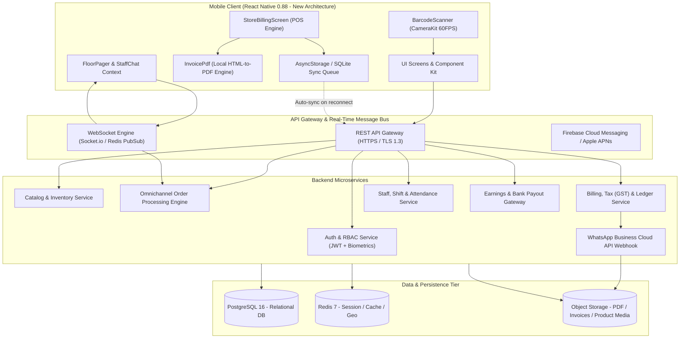
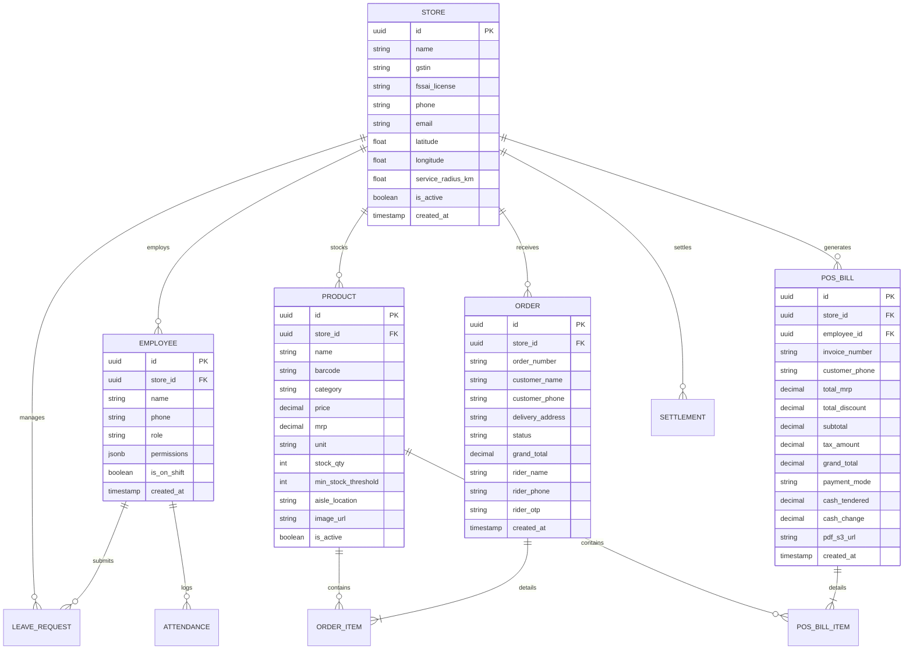

# SmartMart Vendor & In-Store POS Operating System
## Master Technical & Business Specification Document (A-to-Z Screens & Backend Integration Guide)

---

### Document Information
- **Product Name**: SmartMart Vendor (Retail & Supermarket Operating System)
- **Document Version**: 2.4.0 (Enterprise Edition)
- **Target Audience**: Backend Engineers, Mobile Developers, Technical Architects, Store Owners, Enterprise Clients & Stakeholders
- **Supported Platforms**: iOS (Apple Silicon & Intel, iOS 14.0+), Android (API Level 24+, Android 7.0 - 15)
- **Application Framework**: React Native 0.88.0 (New Architecture TurboModules enabled, TypeScript 5.8+)

---

## Table of Contents
1. [Executive Overview & Value Proposition](#1-executive-overview--value-proposition)
2. [High-Level System Architecture](#2-high-level-system-architecture)
3. [User Personas & Role-Based Access Control (RBAC)](#3-user-personas--role-based-access-control-rbac)
4. [A-to-Z Screen Dictionary & Functional Breakdown](#4-a-to-z-screen-dictionary--functional-breakdown)
   - [Auth & Onboarding Module](#41-auth--onboarding-module)
   - [Dashboard & Real-Time Operational Hub](#42-dashboard--real-time-operational-hub)
   - [POS Counter Billing & Tax Invoicing](#43-pos-counter-billing--tax-invoicing)
   - [Barcode Scanning & Instant Price Checker](#44-barcode-scanning--instant-price-checker)
   - [Inventory, Catalog & Stock Management](#45-inventory-catalog--stock-management)
   - [Omnichannel Order Fulfillment & Dark Store Staging](#46-omnichannel-order-fulfillment--dark-store-staging)
   - [Team Management, Attendance & HR Workflow](#47-team-management-attendance--hr-workflow)
   - [Floor Pager & In-Store Team Communication](#48-floor-pager--in-store-team-communication)
   - [Finance, Earnings & Settlement Gateway](#49-finance-earnings--settlement-gateway)
   - [Store Configuration & Operational Settings](#410-store-configuration--operational-settings)
   - [Account, Security, Support & Legal](#411-account-security-support--legal)
5. [Backend Architecture & API Specification](#5-backend-architecture--api-specification)
   - [Database Entity Relationship Diagram (ERD)](#51-database-entity-relationship-diagram-erd)
   - [Authentication & Session Lifecycle](#52-authentication--session-lifecycle)
   - [RESTful API Endpoints Directory](#53-restful-api-endpoints-directory)
   - [Real-Time WebSocket & Push Events Matrix](#54-real-time-websocket--push-events-matrix)
   - [Offline-First Sync Engine & POS Queuing](#55-offline-first-sync-engine--pos-queuing)
   - [WhatsApp Business Cloud Integration](#56-whatsapp-business-cloud-integration)
6. [Client Presentation, Pitch & ROI Deck](#6-client-presentation-pitch--roi-deck)

---

## 1. Executive Overview & Value Proposition

### 1.1 The Retail Challenge
Traditional grocery stores, Indian kirana supermarkets, and regional retail chains operate in high-friction silos:
- In-store walk-in billing is slow, vulnerable to stock shrinkage, and tethered to expensive legacy desktop hardware.
- Online instant-delivery orders (from apps like Blinkit, Zepto, Swiggy Instamart, or custom direct-to-consumer apps) require separate terminals, resulting in manual stock count desynchronization.
- Floor staff communication (cashiers needing a manager's price override, packers locating stock across aisles) relies on shouting across counters or manual phone calls.
- Paper thermal receipts are costly, environmentally wasteful, fade within weeks, and provide zero customer re-engagement channel.

### 1.2 The SmartMart Solution
**SmartMart Vendor** transforms any smartphone or retail tablet into an **Enterprise Retail Command Center**:
1. **Ultra-Fast POS Counter Billing**: 10-second checkout flow with live barcode scanning, automated MRP discount calculation, cash change calculation, and instantaneous digital invoice delivery directly to customer WhatsApp and SMS.
2. **On-Device Offline PDF Generation**: Zero-latency, 100% offline-ready vector PDF rendering of compliant GST Tax Invoices formatted with branded aesthetic card layouts.
3. **Omnichannel Order & Dark Store Picking**: Dynamic aisle-by-aisle picking routes, staging bay allocation, barcode verification, and rider OTP handoff.
4. **Hardware-Free Intercom (Floor Pager)**: One-tap manager summon buzzer with haptic alerts, aisle targeting, and real-time staff collaboration chat.
5. **Granular RBAC Team Management**: Strict CRUD permission matrix (Manager, Cashier, Online Orders Specialist, Inventory Clerk, Floor Supervisor).
6. **Zero-Paper Ecological Tax Invoicing**: Eliminates thermal paper consumables, delivering official GST PDFs instantly to customer WhatsApp.

---

## 2. High-Level System Architecture



---

## 3. User Personas & Role-Based Access Control (RBAC)

SmartMart features a strict multi-persona security model configured in `StaffRoleContext`:

| Role Name | Title in Store | POS Billing | Catalog CRUD | Order Fulfillment | Team / Staff | Financials |
|---|---|---|---|---|---|---|
| **VENDOR (Owner)** | Store Proprietor / Franchisee | Full CRUD | Full CRUD | Full CRUD | Full Admin | Full Access |
| **MANAGER** | Store General Manager | Full CRUD | Create / Update | Full CRUD | View / Approve Leaves | View Store Summary |
| **BILLER** | Counter Cashier | Create / Update (No Void) | Read Only | None | Shift Self-Service | Daily Cash Count Only |
| **ORDERS** | Online Orders Specialist | None | Read Only (Stock) | Full Picking & Dispatch | Shift Self-Service | None |
| **INVENTORY** | Stockroom & Inwarding Clerk | None | Full CRUD | Read Only | Shift Self-Service | Purchase Ledger Only |
| **SUPERVISOR** | Floor Supervisor | Read Only | Adjust Stock Levels | Monitor Picking Queue | View Floor Attendance | None |

---

## 4. A-to-Z Screen Dictionary & Functional Breakdown

Every screen in `SmartMartVendor` is engineered for lightning-fast touch interaction, high-contrast supermarket visibility, and multilingual support.

### 4.1 Auth & Onboarding Module

#### 1. `SplashScreen` (`src/features/auth/screens/SplashScreen.tsx`)
- **Purpose**: App launch entry point, session restoration, and biometric lock verification.
- **UI Elements**: Animated SmartMart emblem, version label, dynamic pulse loader, network status indicator.
- **User Actions**: Automatic check for existing JWT tokens in `@react-native-async-storage`. If session valid, navigates to `BiometricLockProvider` or `MainNavigation`; otherwise redirects to `OnBoardingScreen`.
- **Backend Touchpoints**: `GET /api/v1/auth/verify-token`, `GET /api/v1/store/status`.

#### 2. `OnboardingScreen` (`src/features/auth/screens/OnboardingScreen.tsx`)
- **Purpose**: 3-step value illustration carousel tailored for supermarket vendors and regional retail chains.
- **Slides**:
  1. *Omnichannel Store Management*: Combine in-store walk-in sales with online delivery orders.
  2. *Instant Barcode Billing & WhatsApp Invoicing*: Replace paper rolls with official on-device digital PDF invoices.
  3. *Staff Floor Pager & Real-Time Inventory*: Seamless aisle tracking, manager summoning, and automated low-stock warnings.
- **User Actions**: Swipe slides, pagination dots, "Skip", "Get Started" button leading to `LoginScreen`.

#### 3. `LoginScreen` (`src/features/auth/screens/LoginScreen.tsx`)
- **Purpose**: Multi-factor merchant and staff authentication.
- **UI Elements**:
  - Store Mobile Number / Email input with input masks.
  - Password field with show/hide toggle.
  - Role Selector toggle: Store Owner vs Store Staff.
  - "Login with Biometrics" button (Face ID / Fingerprint) utilizing `BiometricLockProvider`.
  - "Forgot Password?" and "Register New Supermarket" triggers.
- **Validation**: Regex validation on 10-digit Indian phone numbers (`^[6-9]\d{9}$`) or RFC-compliant email.
- **Backend Touchpoints**: `POST /api/v1/auth/login`, `POST /api/v1/auth/staff-login`.

#### 4. `SignupScreen` (`src/features/auth/screens/SignupScreen.tsx`)
- **Purpose**: Supermarket onboarding & KYC compliance registration.
- **UI Elements**: Store Name, Owner Name, Contact Phone (OTP verified), Business Email, Store Address with GPS Pinpoint, GSTIN (15-character alphanumeric verification), Store Trade License, Business Category (Kirana, Supermarket, Organic Produce, Dairy & Bakery).
- **Backend Touchpoints**: `POST /api/v1/auth/register-store`, `POST /api/v1/auth/verify-otp`.

---

### 4.2 Dashboard & Real-Time Operational Hub

#### 5. `VendorHomeScreen` (`src/features/home/screens/VendorHomeScreen.tsx`)
- **Purpose**: Executive Cockpit for Store Owners and Franchise Managers.
- **Key Metrics Displayed**:
  - *Today's Gross Sales*: Total revenue with real-time percentage change vs previous day.
  - *Channel Split*: Online delivery orders vs In-store POS counter walk-ins.
  - *Live Active Orders Pill*: High-priority badge indicating orders waiting for picker assignment.
  - *Low Stock Warning Callout*: Count of SKUs falling below minimum buffer threshold.
- **Quick Action Bar**:
  - `[+] New Walk-In Bill` -> Jumps directly to `StoreBillingScreen`.
  - `[Barcode] Price Checker` -> Jumps to `BarcodeScannerScreen`.
  - `[Box] Add New Product` -> Jumps to `ProductFormScreen`.
  - `[Users] Floor Pager` -> Triggers `ManagerSummonOverlay`.
- **Backend Touchpoints**: `GET /api/v1/analytics/dashboard/summary`, WebSocket subscription to `store:{id}:orders:new`.

#### 6. `EmployeeHomeScreen` (`src/features/home/screens/EmployeeHomeScreen.tsx`)
- **Purpose**: Role-tailored operational home for floor staff.
- **Features**: Current shift timer (e.g. 4h 12m elapsed), assigned aisle/counter location, active picking tickets assigned to this employee, urgent floor pager requests, daily performance badges.
- **Backend Touchpoints**: `GET /api/v1/staff/me/shift`, `GET /api/v1/staff/me/tasks`.

---

### 4.3 POS Counter Billing & Tax Invoicing

#### 7. `StoreBillingScreen` (`src/features/billing/screens/StoreBillingScreen.tsx`)
- **Purpose**: High-speed offline-capable in-store billing counter register.
- **Key Features & UI Controls**:
  - **Live Product Search & Catalog Ribbon**: Filter by categories (`All`, `Dairy`, `Pantry`, `Flours`, `Snacks`, `Beverages`, `Veggies`, `Bakery`, `Care`) or instantaneous name/barcode text search.
  - **Cart Register**:
    - Item title, unit size, quantity counter with fluid scale buttons (`+` / `-`).
    - Struck-through MRP tag alongside discounted selling price.
    - Green dynamic badge calculating exact consumer savings: `Save ₹X`.
  - **Customer Mobile Input**: Mandatory 10-digit phone field. Displays a green `WhatsApp Ready ✓` indicator when valid.
  - **Multi-Mode Payment Switcher**:
    - `CASH`: Displays cash tendered field and automatically computes `Change Returned: ₹X`.
    - `UPI`: Generates dynamic QR code reference for in-store soundbox/UPI counter.
    - `CARD`: POS card machine slip tracking.
  - **Financial Summary Block**: Total MRP (Gross), Store Discount, Subtotal, 5% GST, and Grand Total.
  - **Tax Invoice Modal**:
    - **Tab 1: Market Invoice Doc (PDF)**: High-resolution preview of the cream & sage green A4 document with invoice number, GSTIN, store phone, customer phone, itemized table, payment badge, and return terms.
    - **Tab 2: Compact Slip**: Monospace thermal receipt format designed for 58mm/80mm Bluetooth receipt printers.
  - **Sharing & Dispatch Actions**:
    - `Send Invoice Doc to WhatsApp (+91 ...)`: Generates on-device PDF and offers direct dispatch to the customer's WhatsApp chat with zero external links.
    - `Send via SMS`: Dispatches short confirmation SMS with invoice reference.
    - `Share Doc File`: Opens native system share sheet (AirDrop, Files, Mail, Print).
    - `Finish & Start New Bill`: Resets register and voids active cart for next customer in line.
- **Backend Touchpoints**: `POST /api/v1/billing/invoices/create`, `POST /api/v1/billing/invoices/sync-batch`.

#### 8. `InvoiceDocumentView` (`src/features/billing/components/InvoiceDocumentView.tsx`)
- **Purpose**: Visual on-screen rendering component replicating the exact styling of the printed tax invoice.
- **Visual Design**: Dark green container frame (`#2D5A43`), cream paper body (`#FAF7F2`), beige ribbon header banner (`SMARTMART MARKET`), sage-green table headers (`#5B8266`), verified `PAID VIA` badge, and fresh produce watermark footer.

---

### 4.4 Barcode Scanning & Instant Price Checker

#### 9. `BarcodeScannerScreen` (`src/features/inventory/screens/BarcodeScannerScreen.tsx`)
- **Purpose**: 60 FPS real-time camera scanner for cashier shelf price verification and customer inquiries.
- **Features**:
  - Native hardware camera stream (`react-native-camera-kit`).
  - Laser targeting overlay with animated sweep line and green corner brackets.
  - Real-time EAN-13, EAN-8, UPC-A, QR code decoding.
  - Haptic feedback & scan audio tone on match.
  - Instant Bottom Sheet Card on match:
    - Product Photo, Full Name, Brand, Unit Size.
    - Selling Price vs MRP with percentage savings.
    - Current Shelf Stock & Backroom Inventory.
    - Aisle Location (e.g. *Aisle 2 • Shelf C*).
    - One-tap action: "Add 1 to POS Cart" or "Edit SKU".
- **Backend Touchpoints**: `GET /api/v1/inventory/products/by-barcode/{code}`.

---

### 4.5 Inventory, Catalog & Stock Management

#### 10. `InventoryScreen` (`src/features/inventory/screens/InventoryScreen.tsx`)
- **Purpose**: Full master inventory overview with stock health indicators.
- **Key Tabs**: `All SKUs`, `In Stock`, `Low Stock (<= 5 units)`, `Out of Stock`.
- **Search & Filter**: Real-time filtering by category, aisle, supplier, price range.
- **Backend Touchpoints**: `GET /api/v1/inventory/items?page=1&limit=50`.

#### 11. `StoreProductsScreen` (`src/features/inventory/screens/StoreProductsScreen.tsx`)
- **Purpose**: Grid and list catalog view optimized for rapid price tag updating and shelf replenishment.
- **Inline Actions**: Quick toggle between Active/Archived, quick stock increment (+10 / +50).

#### 12. `ProductFormScreen` (`src/features/inventory/screens/ProductFormScreen.tsx`)
- **Purpose**: Add new product SKU or edit existing store item.
- **Fields**: Product Title, Category, Selling Price, MRP, Tax Slab (0%, 5%, 12%, 18%), Unit Measurement (g, kg, ml, L, Pack, Piece), Barcode (scan button to autofocus camera), Initial Stock Quantity, Minimum Stock Warning Threshold, Aisle / Rack Identifier, Product Images (Camera snap or Gallery picker).
- **Backend Touchpoints**: `POST /api/v1/inventory/products`, `PUT /api/v1/inventory/products/{id}`.

#### 13. `LowStockScreen` (`src/features/inventory/screens/LowStockScreen.tsx`)
- **Purpose**: Critical stock depletion manager to prevent out-of-stock lost revenue.
- **Features**: Lists all items where `currentStock <= minStockThreshold`. Provides 1-tap "Create Purchase Order Requisition" and automated vendor supplier WhatsApp ordering.
- **Backend Touchpoints**: `GET /api/v1/inventory/low-stock`, `POST /api/v1/inventory/reorder`.

---

### 4.6 Omnichannel Order Fulfillment & Dark Store Staging

#### 14. `VendorOrdersScreen` (`src/features/orders/screens/VendorOrdersScreen.tsx`)
- **Purpose**: Central dispatch monitor for online quick-commerce delivery orders.
- **Filter Tabs**:
  - `New / Pending`: Incoming orders requiring merchant acceptance (audible siren alert).
  - `Picking / Preparing`: Staff actively navigating aisles with picking cart.
  - `Ready for Rider`: Sealed bags staged at counter awaiting rider arrival.
  - `Out for Delivery`: Assigned to delivery partner (Blinkit, Zepto, or In-House rider).
  - `Completed`: Delivered orders with proof of delivery timestamp.
  - `Cancelled / Void`: Rejected orders with cancellation reason log.
- **Backend Touchpoints**: `GET /api/v1/orders?status={tab}`, `PATCH /api/v1/orders/{id}/status`.

#### 15. `OrderDetailScreen` (`src/features/orders/screens/OrderDetailScreen.tsx`)
- **Purpose**: Deep dive into individual order tickets for picker item-by-item verification.
- **UI Elements**:
  - Customer Name, Delivery Address, Estimated Delivery SLA (e.g. *11 mins remaining*).
  - Delivery Partner Rider card: Rider photo, name, phone, live vehicle GPS ETA.
  - Interactive Picker Checklist: Each SKU features a checkbox and barcode scan icon to ensure zero picking errors.
  - Bagging & Staging Bay selector (e.g. *Staging Counter Bay #4, Bag #B-42*).
  - Handover Button: Prompts rider 4-digit verification PIN before releasing package.
- **Backend Touchpoints**: `GET /api/v1/orders/{id}`, `POST /api/v1/orders/{id}/verify-dispatch`.

#### 16. `DeliveryNavigation` (`src/app/navigation/DeliveryNavigation.tsx`)
- **Purpose**: Dedicated Dark Store Fulfillment module for store runners and dispatch supervisors.
- **Workflow Tabs**:
  - `In-Store Fulfillment`: Live queue of orders segmented by target SLA (*Urgent 4 mins target*, *High 6 mins target*).
  - `Store Billing`: Fast access for counter cashiering.
  - `Catalog Products`: Aisle stock checking.
  - `Staff Profile`: Shift status & logout controls.

---

### 4.7 Team Management, Attendance & HR Workflow

#### 17. `TeamManagementScreen` (`src/features/team/screens/TeamManagementScreen.tsx`)
- **Purpose**: Supermarket staff management hub.
- **Features**: Staff list cards with role badges (Manager, Cashier, Inventory, Orders), active on-shift status (Online / Clocked In / On Break / Absent), quick call button, and add employee trigger.
- **Backend Touchpoints**: `GET /api/v1/staff/employees`.

#### 18. `AddEmployeeScreen` (`src/features/team/screens/AddEmployeeScreen.tsx`)
- **Purpose**: Register new store employee and configure RBAC access controls.
- **Input Fields**: Full Name, Phone Number, Emergency Contact, Role Dropdown, Aisle Assignment, Shift Hours, Custom Permissions Toggles (Allow Price Overrides, Allow POS Void, Allow Stock Archival).
- **Backend Touchpoints**: `POST /api/v1/staff/employees`.

#### 19. `EmployeeDetailScreen` (`src/features/team/screens/EmployeeDetailScreen.tsx`)
- **Purpose**: 360-degree employee overview.
- **Data Sections**: Contact info, assigned permissions list, month-to-date attendance score, average picking speed per ticket, POS counter cash reconciliation record.

#### 20. `EmployeeShiftAttendanceScreen` (`src/features/team/screens/EmployeeShiftAttendanceScreen.tsx`)
- **Purpose**: Time clock and monthly attendance tracking.
- **Features**: Daily Clock-In and Clock-Out logs with geo-fence verification (ensures staff are physically inside supermarket radius when clocking in), overtime tracking, and leave application portal.
- **Leave Requests Management**: Employees can apply for *Casual Leave*, *Sick Leave*, *Emergency Leave*, and *Shift Swap*. Displays manager approval/rejection state and audit notes.
- **Backend Touchpoints**: `POST /api/v1/staff/attendance/clock-in`, `POST /api/v1/staff/leaves/apply`, `GET /api/v1/staff/leaves`.

#### 21. `EmployeeTasksActivityScreen` (`src/features/team/screens/EmployeeTasksActivityScreen.tsx`)
- **Purpose**: Shift task assignment board (e.g. *Restock Dairy Fridge*, *Audit Aisle 4 Rice Bags*, *Cashier Counter 2 Peak Shift*).

#### 22. `EmployeeGuidelinesSOPScreen` (`src/features/team/screens/EmployeeGuidelinesSOPScreen.tsx`)
- **Purpose**: In-app digital operating procedures covering food hygiene, fragile item packing standards, POS billing return policies, and shoplifting protocols.

#### 23. `EmployeeNoticeBoardScreen` (`src/features/team/screens/EmployeeNoticeBoardScreen.tsx`)
- **Purpose**: Broadcast notices from Store Owner (e.g. *Diwali Festival Sale Timings*, *Weekly Inventory Audit This Wednesday*).

#### 24. `TeamAnalyticsScreen` (`src/features/team/screens/TeamAnalyticsScreen.tsx`)
- **Purpose**: Managerial productivity dashboard tracking store throughput: average order picking duration, bills processed per cashier per hour, and attendance punctuality index.

---

### 4.8 Floor Pager & In-Store Team Communication

#### 25. `ManagerSummonOverlay` (`src/features/team/components/ManagerSummonOverlay.tsx`)
- **Purpose**: Hardware-free digital intercom / floor pager.
- **Trigger**: Accessible from the persistent header icon or floor pager quick action.
- **Functionality**: A cashier or picker taps a target location (*Counter 1*, *Counter 2*, *Aisle 3 Produce*, *Staging Bay*), selects priority (*Normal Assistance*, *Price Override*, *Urgent Security/Spill*). Sends a persistent high-priority push and haptic vibration alert to all Store Managers.
- **Backend Touchpoints**: WebSocket event `floor_pager:summon`.

#### 26. `TeamChatListScreen` & `TeamChatConversationScreen` (`src/features/team/screens/TeamChatListScreen.tsx`, `TeamChatConversationScreen.tsx`)
- **Purpose**: Internal store messaging without sharing personal mobile numbers on public apps.
- **Channels**: `#general-store-floor`, `#billing-counters`, `#online-dispatch-riders`, plus 1-on-1 direct staff chats.
- **Backend Touchpoints**: WebSocket `chat:message`, `chat:history`.

---

### 4.9 Finance, Earnings & Settlement Gateway

#### 27. `EarningsScreen` (`src/features/earnings/screens/EarningsScreen.tsx`)
- **Purpose**: Supermarket revenue, tax liability, and settlement ledger.
- **Metrics**: Total Gross Volume (POS + Delivery), Platform Commission Deductions, TDS / TCS Tax Deducted, Net Bank Payout Amount, Next Scheduled Settlement Date.
- **Filter Range**: Today, This Week, This Month, Custom Financial Quarter.
- **Backend Touchpoints**: `GET /api/v1/finance/earnings/summary`.

#### 28. `SettlementDetailScreen` (`src/features/earnings/screens/SettlementDetailScreen.tsx`)
- **Purpose**: Deep dive into individual bank deposits.
- **Fields**: Bank Account Number (masked), NEFT/RTGS UTR Reference Number, Settlement Date/Time, Detailed invoice-by-invoice breakdown, Download Tax Certificate button.
- **Backend Touchpoints**: `GET /api/v1/finance/settlements/{utr}`.

---

### 4.10 Store Configuration & Operational Settings

#### 29. `VendorSettingsScreen` (`src/features/settings/screens/VendorSettingsScreen.tsx`)
- **Purpose**: Master store configuration menu.

#### 30. `StoreProfileScreen` (`src/features/settings/screens/StoreProfileScreen.tsx`)
- **Purpose**: Store branding and legal information.
- **Fields**: Store Trading Name, Brand Logo, Store Front Photo, Registered GSTIN, FSSAI Food License Number, Official Support Phone.

#### 31. `StoreAddressScreen` (`src/features/settings/screens/StoreAddressScreen.tsx`)
- **Purpose**: Geofencing and fulfillment territory settings.
- **Fields**: Latitude/Longitude GPS Pin, Store Door Number, Landmark, Delivery Fulfillment Radius in Kilometers (e.g. *5.0 km*).

#### 32. `WorkingHoursScreen` (`src/features/settings/screens/WorkingHoursScreen.tsx`)
- **Purpose**: Operational hours schedule.
- **Fields**: Monday through Sunday Open/Close time pickers, Store Pause / Emergency Offline toggle (temporarily halts incoming online orders during heavy floor rush).

#### 33. `CommissionRateScreen` (`src/features/settings/screens/CommissionRateScreen.tsx`)
- **Purpose**: Transparent breakdown of marketplace commission tier, payment gateway fees (Razorpay / UPI), and merchant tier benefits.

#### 34. `NotificationPreferencesScreen` (`src/features/settings/screens/NotificationPreferencesScreen.tsx`)
- **Purpose**: Granular notification toggle switches: High-Volume Siren on New Order, Daily WhatsApp Business Summary, Low Stock Alert Threshold, Floor Pager Audible Buzz.

---

### 4.11 Account, Security, Support & Legal

#### 35. `ProfileScreen` & `EditProfileScreen` (`src/features/account/screens/ProfileScreen.tsx`, `EditProfileScreen.tsx`)
- **Purpose**: Store Owner account profile, email, phone, security credential management.

#### 36. `AddressScreen` & `AddEditAddressScreen` (`src/features/account/screens/AddressScreen.tsx`, `AddEditAddressScreen.tsx`)
- **Purpose**: Secondary warehouses, supplier pickup addresses, and hub fulfillment centers.

#### 37. `PaymentMethodsScreen` & `AddPaymentMethodScreen` (`src/features/account/screens/PaymentMethodsScreen.tsx`, `AddPaymentMethodScreen.tsx`)
- **Purpose**: Bank account details (Account Number, IFSC, Account Holder Name, Bank Branch) for automated daily settlement deposits. Integrated with Razorpay payouts.

#### 38. `NotificationsScreen` (`src/features/account/screens/NotificationsScreen.tsx`)
- **Purpose**: Comprehensive store activity notification inbox (Order updates, payment credits, leave requests, low stock alarms).

#### 39. `SettingsScreen` (`src/features/account/screens/SettingsScreen.tsx`)
- **Purpose**: App-level configurations:
  - Multi-Language Switcher (English, हिन्दी, ਪੰਜਾਬੀ, বাংলা, ગુજરાતી, मराठी, தமிழ், తెలుగు, ಕನ್ನಡ).
  - Biometric Lock Toggle (Require Face ID / Fingerprint on app resume).
  - Dark Mode / High-Contrast Counter Mode toggle.

#### 40. `HelpScreen` & `LiveChatScreen` (`src/features/support/screens/HelpScreen.tsx`, `LiveChatScreen.tsx`)
- **Purpose**: Merchant helpdesk, FAQ library, and 24/7 priority live chat support with SmartMart Partner Operations.

#### 41. `PrivacyPolicyScreen` & `TermsOfServiceScreen` (`src/features/legal/screens/PrivacyPolicyScreen.tsx`, `TermsOfServiceScreen.tsx`)
- **Purpose**: Statutory compliance documents detailing data governance, GST documentation obligations, and merchant confidentiality.

---

## 5. Backend Architecture & API Specification

### 5.1 Database Entity Relationship Diagram (ERD)



---

### 5.2 Authentication & Session Lifecycle

- **JWT Dual-Token Standard**:
  - `access_token`: Short-lived (15 minutes), passed in header `Authorization: Bearer <token>`. Contains `{ sub, store_id, role, permissions }`.
  - `refresh_token`: Long-lived (30 days), stored securely in device hardware keychain via biometric protection.
- **Biometric Signature**: On Face ID / Touch ID success, device hardware key signs challenge nonce for instant frictionless resume.

---

### 5.3 RESTful API Endpoints Directory

#### A. Authentication & Merchant Onboarding
```http
POST /api/v1/auth/login
Content-Type: application/json
Request Body:
{
  "identifier": "9876543210",
  "password": "SecurePassword123!",
  "role": "VENDOR" // or "STAFF"
}
Response 200 OK:
{
  "success": true,
  "accessToken": "eyJhbGciOi...",
  "refreshToken": "dGhpcy1pcy1...",
  "store": {
    "id": "store-8821",
    "name": "SmartMart Supermarket",
    "gstin": "07AAACG1829K1Z4"
  },
  "user": {
    "id": "usr-1",
    "name": "Rahul Sharma",
    "role": "MANAGER"
  }
}
```

```http
POST /api/v1/auth/register-store
Content-Type: application/json
Request Body:
{
  "storeName": "Green Farm Supermarket",
  "ownerName": "Rajesh Kumar",
  "phone": "9812345678",
  "email": "rajesh@greenfarm.com",
  "gstin": "07AABCG1234F1Z9",
  "address": "Shop 14, Sector 18, Gurugram, Haryana",
  "latitude": 28.4892,
  "longitude": 77.0872,
  "category": "Supermarket"
}
```

#### B. POS Billing & Invoicing Engine
```http
POST /api/v1/billing/invoices/create
Headers:
  Authorization: Bearer <token>
Content-Type: application/json
Request Body:
{
  "invoiceNumber": "INV-463197",
  "customerPhone": "9879091192",
  "paymentMode": "CASH", // "CASH" | "UPI" | "CARD"
  "cashTendered": 200.00,
  "cashChange": 42.00,
  "items": [
    {
      "productId": "prod-1",
      "barcode": "890126201015",
      "name": "Amul Taaza Toned Milk",
      "quantity": 2,
      "price": 54.00,
      "mrp": 58.00,
      "unit": "1L"
    },
    {
      "productId": "prod-5",
      "barcode": "890105885220",
      "name": "Maggi 2-Minute Masala Noodles",
      "quantity": 3,
      "price": 14.00,
      "mrp": 16.00,
      "unit": "70g"
    }
  ],
  "totalMrp": 164.00,
  "totalDiscount": 14.00,
  "subtotal": 150.00,
  "tax": 8.00,
  "grandTotal": 158.00
}
Response 201 Created:
{
  "success": true,
  "invoiceId": "inv-uuid-99",
  "invoiceNumber": "INV-463197",
  "hostedPdfUrl": "https://cdn.smartmart.store/invoices/INV-463197.pdf",
  "whatsAppSent": true,
  "syncedAt": "2026-10-29T10:15:00Z"
}
```

#### C. Inventory & Barcode Lookup
```http
GET /api/v1/inventory/products/by-barcode/{code}
Headers:
  Authorization: Bearer <token>
Response 200 OK:
{
  "id": "prod-1",
  "barcode": "890126201015",
  "name": "Amul Taaza Toned Milk",
  "category": "Dairy",
  "price": 54.00,
  "mrp": 58.00,
  "unit": "1L",
  "stock": 24,
  "minStockThreshold": 5,
  "aisleLocation": "Aisle 2 • Dairy Chiller #1",
  "imageUrl": "https://cdn.smartmart.store/products/amul_taaza.jpg"
}
```

```http
POST /api/v1/inventory/products
Headers:
  Authorization: Bearer <token>
Content-Type: application/json
Request Body:
{
  "barcode": "890106301112",
  "name": "Britannia Good Day Butter",
  "category": "Bakery",
  "price": 30.00,
  "mrp": 35.00,
  "unit": "120g",
  "stock": 48,
  "minStockThreshold": 10,
  "aisleLocation": "Aisle 3 • Shelf B"
}
```

#### D. Omnichannel Orders & Dispatch
```http
GET /api/v1/orders?status=PENDING&page=1&limit=20
Headers:
  Authorization: Bearer <token>
Response 200 OK:
{
  "orders": [
    {
      "id": "ord-1024",
      "orderNumber": "TK-1024",
      "customerName": "Simran Kaur",
      "customerPhone": "9811122233",
      "stage": "To Pick",
      "slaTargetMinutes": 4,
      "items": [
        { "name": "Amul Butter 500g", "quantity": 1, "aisle": "Aisle 2" },
        { "name": "Brown Bread 400g", "quantity": 2, "aisle": "Aisle 3" }
      ],
      "grandTotal": 340.00
    }
  ]
}
```

```http
PATCH /api/v1/orders/{id}/status
Headers:
  Authorization: Bearer <token>
Content-Type: application/json
Request Body:
{
  "status": "READY_FOR_RIDER", // "ACCEPTED" | "PICKING" | "READY_FOR_RIDER" | "DISPATCHED"
  "stagingBay": "Bay #4",
  "bagNumber": "B-42"
}
```

#### E. Staff Attendance & Leave Management
```http
POST /api/v1/staff/attendance/clock-in
Headers:
  Authorization: Bearer <token>
Content-Type: application/json
Request Body:
{
  "employeeId": "emp-2",
  "latitude": 28.4893,
  "longitude": 77.0871,
  "deviceTimestamp": "2026-10-29T09:00:00Z"
}
Response 200 OK:
{
  "status": "CLOCKED_IN",
  "shiftId": "shift-991",
  "withinStoreGeofence": true
}
```

```http
POST /api/v1/staff/leaves/apply
Headers:
  Authorization: Bearer <token>
Content-Type: application/json
Request Body:
{
  "type": "Casual Leave", // "Casual Leave" | "Sick Leave" | "Emergency" | "Shift Swap"
  "startDate": "2026-10-30",
  "endDate": "2026-10-31",
  "days": 2,
  "reason": "Family wedding in Jaipur"
}
```

---

### 5.4 Real-Time WebSocket & Push Events Matrix

The app connects to WebSocket endpoint `wss://api.smartmart.store/socket.io`:

| Channel / Topic | Event Name | Payload Summary | Mobile Action |
|---|---|---|---|
| `store:{id}:orders` | `order:incoming` | `{ orderId, itemsCount, slaMinutes, total }` | Plays audible siren sound, vibrates device, adds ticket to Orders queue |
| `store:{id}:orders` | `order:rider_arrived` | `{ orderId, riderName, riderPhone, vehicleNo }` | Pops dispatch modal with OTP entry |
| `store:{id}:pager` | `floor_pager:summon` | `{ location: "Counter 2", priority: "URGENT", reason: "Price Override" }` | Displays modal `ManagerSummonOverlay`, heavy vibration buzz |
| `store:{id}:chat` | `chat:new_message` | `{ senderId, senderName, channel, text, timestamp }` | Increments unread badge, updates chat thread |
| `store:{id}:inventory`| `inventory:low_stock` | `{ productId, name, currentStock }` | Triggers notification banner, updates LowStock screen |

---

### 5.5 Offline-First Sync Engine & POS Queuing

Supermarket billing counters cannot stop if internet connectivity drops. SmartMart incorporates an **Autonomous Offline Engine**:
1. **Local Catalog Cache**: Full product catalog with barcodes and prices is cached locally in SQLite / encrypted storage.
2. **Offline Invoice Ledger**: When offline, bills are generated locally with sequential offline identifiers (`INV-OFF-<timestamp>-<rand>`).
3. **On-Device PDF Generation**: Vector PDF is built 100% locally on the device using `react-native-html-to-pdf` without server connection.
4. **Batch Sync Queue**: When connectivity restores (`NetInfo` status change to `online`):
   - Device calls `POST /api/v1/billing/invoices/sync-batch`.
   - Backend reconciles stock quantities, applies idempotency checks, and confirms server ledger.

---

### 5.6 WhatsApp Business Cloud Integration

When an invoice is issued at the POS counter:
1. **Direct Deep Link**: Client initiates WhatsApp interaction via native application scheme without intermediary web links.
2. **Enterprise Cloud Webhook (Optional Server Automated Dispatch)**:
   - Backend triggers Meta WhatsApp Business Cloud API (`POST https://graph.facebook.com/v20.0/{Phone-Number-ID}/messages`):
   - Sends official pre-approved WhatsApp Utility Template containing the PDF invoice attachment (`application/pdf`) and store greeting.

---

## 6. Client Presentation, Pitch & ROI Deck

### 6.1 Executive Summary for Retail Chains & Kirana Owners
> *"SmartMart Vendor converts traditional, chaotic grocery checkout counters into high-speed, paperless digital superstores."*

### 6.2 Key ROI Metrics
- **70% Reduction in Checkout Wait Times**: Instant 60 FPS barcode scanning replaces manual SKU searching on slow Windows desktop computers.
- **₹18,000 Annual Savings on Thermal Paper Rolls per Counter**: Paperless WhatsApp PDF invoices eliminate expensive thermal printer hardware and roll replacements.
- **99.8% Picking Accuracy**: Built-in barcode verification on online delivery orders prevents wrong item packaging and customer refund chargebacks.
- **100% Zero Internet Dependency**: Walk-in sales continue uninterrupted during network outages through local offline caching.
- **Full Legal GST Compliance**: Pre-formatted tax invoices detailing CGST, SGST, IGST, store GSTIN, customer mobile numbers, and audit trails.

---
*End of Specification Document • SmartMart Retail Technologies Inc.*

